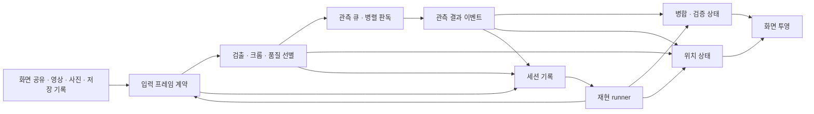

# 입력 기록과 재현 구조

## 개발 기준

새로 제공받는 영상·사진·화면 공유 기록을 개별 검증 사례로 누적한다. 새 입력이 이전 입력을 교체하지 않는다. 수정 전후에 같은 사례들을 실행해 카드 판독, 위치 연결, 진행 표시와 처리 시간을 각각 비교한다.

원본 입력, 프로그램이 관측한 결과, 사람이 확인한 기대값은 서로 다른 자료다. 수량이 일치하거나 이전 버전과 같다는 이유로 프로그램 출력을 정답으로 승격하지 않는다. 이 문서는 전환 설계이며, 아래 단계가 모두 현재 앱에 연결됐다는 뜻은 아니다.

## 목표와 측정

`finishTiming.measurementBasis=first-identified-card-captures`는 현재 실행에서 최종 식별한 카드별 첫 캡처 시각 중 가장 늦은 시각을 기준으로 한다. `withinTarget`은 이 기준의 10초 비교일 뿐, 가림 없는 최신 각성·장수 입력의 충분성을 증명하지 않는다. 따라서 `sufficientInputVerified=false`를 함께 기록한다. 이 표식이 없는 과거 기록도 충분한 입력이 검증된 것으로 승격하지 않는다. 실제 목표 달성 검증은 입력 충분성 근거와 최종 필드 확인을 별도로 요구한다. 완료 시각이 이름 수집 시각보다 이르거나 유한하지 않으면 측정을 거부한다.

### 구현 우선순위와 단계별 완료

1. **실사용 스캐너**: 기본 스캔은 전체 입력 기록을 끈다. 수집·판독 상태의 화면 반영, 최신 필드 검증, 자동 종료와 기존 입력의 필드 회귀를 먼저 확인한다. 아래 지연 목표는 반복 실시간 검사와 실제 공유에서 검증하고, 표본 수·측정하지 못한 범위를 함께 보고한다. 이 단계가 사용 가능해지면 전체 재현 완성 전에도 사용자에게 알린다.
2. **가벼운 실패 기록**: 기본 진단 요약과 제한된 문제 이미지를 유지한다. 원본 입력 전체가 없는 요약을 완전 재현 자료라고 표시하지 않는다. 저장 비용과 한도가 스캔 완료를 막지 않는지 별도 검증한다.
3. **개발용 전체 재현**: 스캔 진단에서 명시적으로 켜는 옵션으로 둔다. 입력 순서·해시·보존 범위, 저장 완료, 픽셀 재판독과 공통 상태 재생을 검증한다. 용량 초과로 일부만 저장된 기록은 성공으로 판정하지 않는다.

단계는 작업 순서이며 최종 목표의 축소가 아니다. 전체 재현의 저장 용량 문제 때문에 실사용 개선을 보류하지 않으며, 어느 단계도 수량 일치만으로 완료했다고 판단하지 않는다.

전체 입력 기록 옵션은 종료 후 재현용 입력을 보관하는 설정이다. 기본 진단 모드에서는 연속 영상·임시 원본 영상 저장소를 만들지 않지만, 수집 큐·판독 크롭·제한된 문제 이미지에는 메모리가 필요하다. 상세 모드에서는 저장 영상을 보완 판독에 사용할 수 있다. 두 모드의 입력 수집률·종료 후 지연·저장량을 분리해 비교하며 기본 진단을 저장 비용 0으로 해석하지 않는다.

기본 요약의 `imageRetention`은 이미지 후보 시도 수·중복·한도 제외·형식 오류와 보관한 인코딩 문자열 길이를 남긴다. 후보 시도는 고유 카드 수가 아니며, 거절한 이미지를 집계하기 위해 추가로 보관하지 않는다. 한도 제외와 형식 오류는 진단 경고에도 표시한다. 오래된 요약에 이 필드가 없으면 생략이 없었다고 단정하지 않는다.

최우선 목표는 같은 실패를 다시 실행할 수 있는 구조와, 사용자가 작업 상태를 즉시 구분할 수 있는 반응성이다. 인식 기준을 느슨하게 바꿔 체크를 빨리 채우는 방식은 사용하지 않는다.

| 항목 | 목표 | 측정 경계 |
|---|---|---|
| 위치 피드백 | p95 150ms 이내 | 현재 프레임의 스크롤 샘플 → 진행창 반영 |
| 수집 피드백 | p95 100ms 이내 | 쓸 수 있는 크롭의 수락 → 판독 대기 표시 |
| 판독 피드백 | p95 100ms 이내 | reader 시작·종료 사실 → 판독 중·완료/확인 표시 |
| 최종 정리 | 마지막 유효 입력 이후 10초 이내 | 모든 필요한 카드가 실제로 노출된 시점 → 최신 필드 검증·자동 공유 종료 |
| 재현 일관성 | 같은 사실·설정·도착 순서는 같은 상태 해시 | 순수 상태 재생, 지연된 과거 관측과 재시도의 최신 증거 보호 |
| 정확성 | 기존 검증 사례의 필드 회귀 없음 | 확인한 정답 범위를 명시해 이름·각성·장수·경험치 비교 |

이는 구현 완료 수치가 아니라 검증 목표다. 화면에 오지 않은 카드나 가려진 필드를 읽었다고 가정하지 않는다. 모델 준비, 입력 노출, 수집 대기, 판독, UI 발행, 최종 정리는 시간을 따로 기록한다. 기기·브라우저·기록 옵션이 다른 성능 결과를 하나로 합치지 않는다.

10초는 강제 종료 제한이 아니라 최적화 목표다. 달성하지 못하는 환경에서도 정확성을 유지하면서 지연을 줄이고, 변경 전후 실측과 남은 시간을 보고한다. 목표 시간을 맞추기 위해 미확정 필드를 완료로 바꾸거나 필요한 관측을 버리지 않는다.

입력 대기·획득 지연과 프레임 보관량은 기존 실행 기록에서 분석한다:

```sh
node --import tsx scripts/analyze-input-delivery.mjs work/run.json
```

`inputResources.queueWait`는 큐에 전달한 시점부터 획득 시작까지, `acquisition`은 소비 시작부터 종료까지의 같은 결정 시계 구간이다. 캡처부터 화면 표시까지의 지연이나 OCR 지연과 다르다. `rasterEstimate`는 활성·대기·교체 전 신규 프레임의 크기 기반 추정치다. 신규 프레임이 기존 프레임을 대체하기 전의 순간도 포함하므로 보관 한도를 일시적으로 넘을 수 있다. GPU·OCR 모델·카드 크롭·전체 브라우저 메모리는 포함하지 않는다. 해제 실패는 남은 물리 메모리 미확인으로, 누락된 기록은 부분 측정으로 표시한다. 이 분석은 라이브 경로에 추가 샘플링을 넣지 않는다.

반복 실시간 실행은 `node scripts/compare-live-runs.mjs <before.json> <after.json>`으로 비교한다. 빈 목록에서 시작하고 실행 중 소스가 바뀌지 않은 보고서만 받는다. 입력 순서·해시, 실행 설정·기록 여부·브라우저·탭 숨김 여부의 차이와 누락된 비교 조건을 표시하고, 카드별 결과 및 수집 처리량을 나란히 남긴다. 같은 코드·영상이라도 전달된 프레임이나 시스템 부하는 같지 않으므로 한 번의 빠른 실행을 개선 증거로 삼지 않는다. 미완료 결과를 빠른 완료로 평가하지 않으며, 없는 시간 지표는 0 대신 미측정으로 둔다.

입력 전달 차이는 `node --import tsx scripts/analyze-input-delivery.mjs <run.json>`으로 확인한다. 원본 영상 콜백의 미디어 시각 간격과 콜백 수신 시각 간격을 재생별로 분리하고, 라이브·보완 획득의 관측 수와 관측이 존재하는 프레임 수, 입력 대체·용량 제한을 집계한다. 콜백이 없거나 하나뿐이면 간격은 미측정이며, 시각 역전은 별도로 표시한다. 서로 다른 시계의 타임스탬프로 프레임을 연결하지 않는다. 콜백 공백은 원본 픽셀 누락의 증명이 아니고, 획득 관측이 없는 프레임은 프레임 수에 포함되지 않는다. 출력의 보고서 해시로 분석 대상을 식별하며 부분 기록은 부분 측정으로 남긴다.

비교 보고서의 `afterInputFinishedMs`는 영상 입력 종료부터 실행 반환까지의 시간이다. `afterLastIdentifiedCardMs`는 스캐너 시계의 마지막 식별 카드 캡처 시각부터 처리 종료까지를 계산한다. 미획득 카드의 유효 노출이나 화면 표시 지연을 증명하지 않으며, 저장된 목표 달성 플래그 대신 실제 시각 차이를 사용하고 전체 판독 완료 여부를 따로 검사한다. 보완 검사 프레임 수·획득 시간·판독 시간은 따로 표시하며, 병렬 작업 시간은 합산해 경과 시간으로 해석하지 않는다. 기록이 없는 지표와 역전된 시각은 0으로 보정하지 않고 미측정으로 남긴다.

`feedback`은 위치·수집·판독 시작·판독 종료를 분리해 실제 표시 대상과 연결된 표본 수와 지연을 보고한다. 표본이 0이면 `unmeasured`, 기록 자체가 없으면 `missing`이다. 표본이 있어도 제한된 대상의 부분 측정이며 전체 상태 전이나 실제 화면 paint를 증명하지 않는다. UI 성능 검증 때는 진행창을 뷰포트 안에 둔다. 화면 밖의 진행창이나 숨겨진 탭에서 표본이 없었던 결과를 React commit 시간으로 대신해 통과시키지 않는다.

DOM 확인에서 빠진 표본은 `domTargetRejected`(상태·대상 불일치), `domVisibilityRejected`(표시 영역·가시성 조건 불충족), `domInspectionFailed`(DOM 검사 예외)로 구분한다. 카운터는 현재 발행된 상태의 소유된 binding에만 적용하며, 실패를 성공 표본으로 바꾸지 않는다. 실제 DOM 대상까지 연결되지 못한 사실은 기존 projection·binding 카운터로 별도 확인한다.

진행창의 최근 화면 요약은 바로 아래 40칸에 표시한 `recentFrame.cells`를 집계한다. 정보 없는 칸·카드 없는 칸을 판독 대기로 바꾸지 않는다. 전체 작업 대기열의 건수와 최근 화면에 표시된 칸수는 범위와 단위가 다르며, 이전 수집 요약으로 현재 화면의 상태를 대신하지 않는다. 개발 표시 검사 페이지의 `최근 화면 혼합 상태`는 이 불일치를 재현하는 합성 사례다.

입력 전달 분석의 `inputAdmission`은 실제 admission 정책으로 기록된 결정을 재생해 수집 허용·건너뛰기 이유와 프레임 고정 성공·실패를 구분한다. `cadenceSpacing`은 간격 제한으로 건너뛴 입력이 직전 성공한 프레임 고정 이후 몇 ms에 도착했는지 보여 준다. 25~33ms 구간은 30fps 콜백의 전달 흔들림을 조사하기 위한 구간이며, 해당 픽셀이나 누락 카드의 존재를 증명하지 않는다. 결정이 현재 정책과 다르면 분석을 실패시켜 정책 변경을 숨기지 않는다. 이 분석은 저장된 사건만 사용하며 라이브 경로에 픽셀 저장이나 추가 샘플링을 넣지 않는다.

## 역할

개발 페이지의 `offerFloor=0|16|33`은 입력 고정의 기본 최소 간격(33ms)을 비교하는 실험이다. 고정 비용 기반 제한·명시적 fps 제한·대기열 개수·메모리 상한은 유지한다. 선택값을 실행 설정과 각 admission 사건에 보존하며 기본값과 배포 앱은 변경하지 않는다. 수집 허용 증가를 누락 해결로 간주하지 않고 동일 영상의 최종 필드·미확정·대기열 교체·지연을 함께 비교한다.

판독 대기 병목은 `node --import tsx scripts/analyze-observation-timing.mjs <run.json>`으로 첫 대기·재시도·작업 구간을 나누어 검사한다. `node --import tsx scripts/analyze-recognition-tail.mjs <run.json>`은 이름 수집 후에도 판독하는 관측 그룹을 분석한다. `crossGroupFieldRevisions`는 같은 획득 세션에서 동일 필드 리비전을 공유하는 그룹의 수다. 다른 세션의 같은 문자열은 합치지 않는다. 최종 카드 ID가 같거나 리비전이 같다는 사실만으로 판독 생략을 허용하지 않으며, 그룹 분리와 최신 필드 근거를 각각 확인한다. 이 도구들은 저장된 기록만 분석하므로 라이브 경로에 추가 측정 비용을 넣지 않는다.

개발 실행의 `performance.mainThreadWork`는 스캐너 호출부터 반환까지 브라우저 Long Tasks API가 보고한 50ms 이상 작업을 측정한다. 페이지 `performance.now()` 기준 시작 시각과 지속 시간을 최대 256개 보관하며 초과 표본 수를 명시한다. 미지원·관측 실패·미실행은 각각 구분하고, 0개라는 이유만으로 모든 지연이 없었다고 해석하지 않는다. Worker CPU 사용이나 프레임 누락의 증명이 아니며 원본 영상 콜백 공백과 함께 병목 후보를 좁히는 진단이다. 일반 앱에는 연결하지 않는다.

`analyze-input-delivery.mjs`의 `callbackStalls`는 같은 playback의 콜백 사이와 Long Tasks의 시간적 겹침을 계산한다. source-playback 사건의 실행 상대 시각에 `clockOrigin.runStartedAtMs`를 더하며, playback 상대 시각이나 scanner 시각을 혼용하지 않는다. 중복 작업 구간은 합집합으로 계산하고 미디어 공백이 큰 20개 구간만 보고한다. 관측 실패·누락된 기준 시각은 미측정, 잘린 사건·작업 표본은 부분 측정이다. 시간적 겹침은 원인 확정이나 픽셀 누락 증명이 아니다.

개발 페이지의 `sourcePresentation=visible`은 1배속 영상의 원본 video를 작은 고정 미리보기에 연결하는 비교 옵션이다. 기본값은 DOM에 연결하지 않은 원본이며 `runtimeConfiguration.playbackSourcePresentation`에 구분을 남긴다. 원본과 스캐너의 입력 video는 별개로 유지하고 종료 시 원본을 제거한다. 획득만 검사와 전체 판독을 각각 비교해 compositor 조건과 판독 부하를 구분한다. 이 옵션은 모든 프레임 전달을 보장하거나 실제 OS 화면 공유를 재현하는 해결책이 아니다.

입력 전달 분석의 `locations`는 세션·처리 단계별로 최초 레이아웃 검출 전후의 미검출을 나눈다. 비동기 콜백 도착 순서 대신 처리 프레임 ID로 정렬하고 중복 사실은 한 프레임으로 집계한다. 충돌한 사실은 별도 표시하며, 최초 검출이 없으면 전후 구분은 미측정이다. 미검출이 실제 창 부재인지 검출 실패인지는 원본 이미지로 확인해야 한다. 레이아웃 검출은 카드 판독 성공이나 스크롤 위치 확정을 뜻하지 않는다.

전체 화면 탐색은 축소된 탐색 래스터의 모든 RGBA 바이트와 입력·탐색 기하가 같을 때만 직전 후보 또는 미검출 결과를 재사용한다. 스냅샷은 한 개, 최대 8 MiB이며 초과 입력은 캐시 없이 탐색한다. 이는 후보 탐색의 재사용일 뿐이다. 원본 해상도 보정과 성장 탭 검증은 각각 현재 픽셀로 확인하고, 카드 크롭·필드 판독·입력 시각을 대신하지 않는다. 같은 축소 픽셀이어도 원본 해상도의 근거가 달라질 수 있으므로 최종 레이아웃을 통째로 재사용하지 않는다.

개발 Worker의 `detectorProfile`은 전체 탐색(`global`), 기존 위치 추적(`tracked`), 원본 해상도 정밀 보정(`refinement`), 성장 탭 검증(`growth`)의 호출 수·정확한 픽셀 캐시 재사용 수·경과 시간을 집계한다. 라이브와 보완 검사 합계는 별도다. 전체 탐색으로 재진입한 호출도 집계하며, 예외나 조기 반환으로 완료하지 못한 단계는 포함하지 않는다. 이는 단계의 경과 시간으로 CPU 시간이나 전체 검출 시간과 동일하지 않다. 배포 Worker에서는 이 상세 측정을 끄고, 기록이 없는 이전 보고서는 미측정으로 취급한다. 좌표와 판독 승인 기준에는 사용하지 않는다.

대기열 분석의 `matchedTaskConcurrency.durationMsByActiveTasks`는 종료까지 기록된 판독 작업이 동시에 실행된 개수별 경과 시간을 보여 준다. 같은 시각의 시작·종료는 합쳐 계산하며, 미종료 작업은 포함하지 않는다. 콜백·스케줄링 시간도 포함하므로 worker CPU 사용률이나 설정된 병렬 슬롯 수로 해석하지 않는다. 판독 공백이 없더라도 병렬 슬롯 전체가 사용됐다는 뜻은 아니다.

이동 재사용 진단은 `shifted`(0이 아닌 행 이동이 제안된 프레임), `moveCompared`(같은 열·크기·패딩 조건을 통과해 캐시를 대조한 칸), `moveMatched`(전체 RGBA가 일치한 칸)를 구분한다. `moved`는 여기에 온전한 테두리와 정수 이동 조건까지 통과한 실제 재사용이다. 제안 실패·기하 조건 불일치·픽셀 불일치를 구분하기 위한 계수이며, 이 수치를 높이기 위해 일치 조건을 완화하지 않는다. 세분 계수가 없는 이전 보고서는 해당 구간을 미측정으로 취급한다.

실시간 보고서의 `live.acquisitionProfile`은 측정된 획득 프레임 수(`samples`), 같은 위치의 정확한 픽셀 재사용(`exact`), 정수 행 이동 후 정확한 픽셀 재사용(`moved`), 신규 검사(`inspected`), 이동 탐색 시간 합계(`probeMs`)를 기록한다. 카드별 정답이나 독립 관측 수가 아니라 획득 작업량이다. 저장된 분석을 통째로 재사용한 프레임·미검출 프레임·측정 없는 fallback은 표본에 넣지 않는다. 시간은 획득 시간의 일부이며 별도 비용처럼 더하지 않는다. 기존 보고서에서 누락된 값은 0으로 해석하지 않는다.

실행 보고서의 대기열 지연은 `node --import tsx scripts/analyze-observation-timing.mjs <private-run-report.json>`으로 분석한다. 라이브의 진행창 명령은 공통 `ScanGrid`에서 관측 사실로 복원하며, 복구 판독의 직접 사실도 함께 분석한다. 최초 대기, 최초 수집부터 재시도까지의 대기, 시작부터 종료까지의 작업 시간을 분리한다. 작업 시간에는 스케줄링과 콜백이 포함되며 worker CPU 시간이나 UI 반영 시간으로 해석하지 않는다. 시작 없는 종료는 상태 보정일 수 있으므로 실패 판독으로 세지 않는다. 기록 누락·미종료 작업은 부분 측정으로 표시한다. 결과 파일은 비공개 로컬 경로에 보관한다.

| 구성 | 단독 책임 | 맡지 않는 책임 |
|---|---|---|
| 입력 어댑터 | 공유·영상·이미지를 원본 시각·단계가 있는 프레임으로 전달 | 카드 식별·최신 값 판정 |
| 획득 Worker | 창 검출, 크롭, 품질·가림 확인 | 카드 목록 확정 |
| 판독 작업자 | 관측 하나의 이름·각성·장수와 근거 반환 | 전역 목록·위치·화면 갱신 |
| 관측 상태 | 대기·판독 중·완료, 시도 ID, 과거 결과 차단 | 인식 신뢰도와 카드 수량 검증 |
| 목록·위치 상태 | 최신 증거 병합, 수량 검증, 확정/추정 위치 구분 | DOM·Canvas·타이머·파일 쓰기 |
| 화면 투영 | 작은 상태 변경을 정해진 빈도로 반영 | 완료 근거 생성·판독 스케줄링 |
| 세션·검증 도구 | 원본·사실·설정 보관, 재생, 차이와 비용 보고 | 프로그램 출력을 정답으로 자동 승격 |

수집·판독·표시·기록은 서로 다른 작업 경로로 움직이며 각 경로의 대기열과 메모리는 상한을 갖는다. 저장이나 썸네일 생성이 밀려도 원본 판독을 기다리게 하지 않는다. 불완전한 기록은 완전 재현으로 표시하지 않는다.

## 개선 루프

관측 대기와 판독 사이 공백은 `node --import tsx scripts/analyze-observation-timing.mjs <비공개-run.json>`으로 구분한다. `readGapEvidence.gapWithFirstReadWaitingMs`는 실제 첫 판독 시작까지 연결된 대기 구간과 판독 작업 사이 공백의 교집합이다. 중첩된 대기는 한 번만 계산한다. 나머지 공백에는 획득·디코딩·재시도 등이 포함될 수 있으며 CPU 유휴나 입력 누락을 뜻하지 않는다. 이 분석은 저장된 실행 시각 기준이며 화면 반영 지연 측정을 대신하지 않는다.

1. 새 입력을 등록하고 해시·순서·원본 보존을 검사한다. 관찰 조건과 사용자가 보고한 현상을 사례에 연결한다.
2. 수정 전 결과를 별도 run으로 남긴다. 사람의 정답 확인은 전체/부분 범위와 근거 위치를 함께 작성한다.
3. 실패가 입력 선택, 획득, 판독, 병합, 위치, 화면 중 어디에서 생겼는지 좁힌다. 상태 오류는 OCR 없이 사실 이벤트로 반복 재현한다.
4. 해당 책임의 코드와 회귀 검사를 수정한다. 개선 전후 결과와 각 단계 지연을 비교한다.
5. 새 사례뿐 아니라 보관한 이전 사례도 실행한다. 의도한 변화와 회귀를 구분한 뒤 다음 변경으로 진행한다.

자동화는 차이 검출과 측정까지 맡는다. 정확성 판단·정답 승격·코드 변경의 채택은 근거를 검토한 뒤 수행한다. 새로 준 실데이터를 특정 카드 이름에 대한 예외 처리로 바로 바꾸지 않는다.

### 스크롤·헤더 측정의 출처

`scroll-capture`는 획득 프레임마다 기존 16×942 스크롤바 읽기를 재사용해, 행 번호로 양자화하기 전의 실제 위치·손잡이 비율을 기록한다. 창 미검출·읽기 실패·화면 밖·대기열 포화는 각각 구분한다. 처리 순번, 획득 요청 ID, 물리 원본 ID, 관측 프레임 별칭과 입력 ID는 서로 바꾸어 쓰지 않는다. 원본 ID가 있다는 사실만으로 저장 ACK를 증명하지 않는다.

`inventory-header-read`는 헤더 픽셀을 복사한 원본·영역과 실제 판독 결과를 연결한다. `captured-header-read.ts`는 비동기 OCR을 기다리기 전에 이 출처를 복사하며, 나중에 보이는 프레임의 좌표로 덮어쓰지 않는다. 스크롤 사건은 가장 최근 성공한 헤더 요청 ID만 참조한다. 이 참조는 헤더가 현재 프레임과 같거나 최신 캡처라는 증거가 아니다. 두 사건은 4KiB 이하의 진단으로 검증하며, 카드 위치·보관함 수량·완료를 확정하는 reducer에는 적용하지 않는다. 진단 실패는 별도 표시하고 카드 획득 근거 기록의 실패 latch와 분리한다.

## 현재 기반과 전환 범위

| 항목 | 현재 상태 | 전환할 동작 |
|---|---|---|
| 새 입력 보관 | 세션별 색인·청크·진단을 누적하고 한도·중단은 부분 기록으로 보관 | 기록 ON/OFF의 실제 입력 누락·시간·메모리 비교를 통과 |
| 픽셀 재현 | 원본 프레임 ID·시각·input/recovery·해시 계약을 보존하는 순차 판독 | 라이브 입력 선택과 같은 스케줄러까지 재생 |
| 실행 재현 | 관측·지도·카드 근거·입력 선택·미식별 경고·최신 필드 미확정을 공통 상태 갱신으로 재생·해시 비교 | 실제 시간 스케줄러와 보관 세션의 시나리오 검사로 연결 |
| 실시간 검증 | 정식 dev runner의 1배속 screen 루프와 실제 진행창 컴포넌트 | 실제 OS 공유와 공통 입력 스케줄러까지 확장 |
| 비교 | 카드 필드와 보관함·판독 수·미식별·경험치 차이, 지원하는 상태 해시 대조 | 시나리오별 위치 정확성·단계 지연·자동 종료 조건을 목적별 비교 |
| 로컬 입력 등록 | 콘텐츠 해시·순서가 있는 누적 코퍼스, 등록 사례 선택 검사, 사례별 불변 실행 보고서 자동 보관 | 사람이 확인한 정답 범위·시나리오를 사례에 연결 |

기존 무손실 블록 코덱, 해시 검사, Worker·OPFS 기록, 독립적인 진행창 저장소는 재사용한다. UI와 인식 알고리즘을 동시에 전부 교체하지 않는다.

### 공통 무손실 입력 보관

sync OPFS 읽기가 가능하고 최초 공유 프레임이 64MiB 이하인 환경은 보완 캡처와 exact 기록을 `canonical-capture`의 한 producer로 보낸다. 같은 원본의 픽셀은 한 번만 읽고 압축·저장하며 획득 Worker의 중복 exact 전달을 끈다. 저널은 이미 인코딩한 바이트만 복제한다. 미지원 환경·큰 해상도·명시적인 디버그 캡처는 기존 raw 보완 경로를 유지한다. 연결과 형식 검사는 구현됐으며 실제 기록 ON/OFF의 처리량·용량 검증은 별도로 통과해야 한다.

- immutable 입력에 공통 `sourceFrameId`를 부여하고 `input`·`backup`·`recovery` 역할과 획득 분석 receipt를 연결한다. 새 처리 역할을 추가한다고 같은 픽셀을 다시 읽고 저장하지 않는다. 원본 ID와 실제 획득 요청 ID는 다른 식별자이며 어느 쪽도 카드 최신값을 판정하지 않는다.
- 임시 보관은 복구에 필요하므로 진단 기록 옵션과 분리한다. 장기 저널 저장만 선택 사항이며 저장 실패가 임시 복구 입력을 제거하지 않는다.
- 복구·내보내기는 같은 입력 저장소를 읽고, 모든 소비자가 합류한 뒤 임시 데이터를 정리한다. 기본 v4/v5 키프레임 색인은 최대 8프레임·누적 복원 작업량 32MiB를 유지한다. 단일 큰 키프레임은 64MiB까지 허용하되 delta를 연결하지 않는다. 개발용 v6의 동시 소유 버퍼 예산은 아래처럼 별도로 검증한다. 열린 파일 읽기는 writer의 이전 프레임 버퍼를 바꾸지 않는다.
- 상세 기록에서는 연속 영상을 유지한다. 현재 exact에는 라이브 획득에서 선택되지 않은 모든 프레임이 들어 있지 않다. 기본 진단 모드의 연속 영상 생략은 로컬 검증 중이며, 빠르게 지나간 구간의 수집률과 종료 후 지연을 별도로 비교한다. 기본 모드의 성공을 상세 기록의 전체 입력 보존 증거로 사용하지 않는다.
- 기록 OFF는 기존처럼 4fps 보완 입력만 임시 보관한다. ON일 때 선택·복구 입력도 보관하며 이미 저장한 원본은 재사용한다. 분석 receipt는 main의 제한된 sidecar에 참조로 유지해 늦게 확인된 카드 이름·필드 근거를 잃지 않는다.
- ON에서 선택된 입력을 같은 저장소가 수락하면 그 캡처 시각을 보완 주기에 함께 반영한다. 늦게 처리된 과거 입력은 주기를 되돌리지 않는다. 따라서 이미 보관한 구간을 백업 타이머가 곧바로 중복 복사하지 않는다.
- 일반 raw 경로의 기록 ON은 입력을 freeze하기 전에 producer의 남은 대기 용량을 검사한다. 일시적으로 부족하면 도착과 `source-capacity` 선택 사실만 기록하고 후속 도착에서 재시도한다. 이미 대기·처리 중인 입력이나 저장 예약은 유지한다. 영구적인 크기 제한·종료·저장 실패를 일시적인 용량 대기로 숨기지 않는다.
- 수락한 raw 입력은 freeze 전에 같은 producer 예산의 바이트를 확보한다. 이 임시 예약에는 원본 ID·복사·저장 작업이 없다. 대표가 실제 획득에 들어가거나 기존 250ms 보완 정책으로 선택될 때만 같은 예약을 물리 저장으로 전환하고 원본 ID를 연결한다. 아직 저장하지 않은 대표가 교체·폐기되면 바이트만 반환한다. 이미 저장한 입력·백업은 그대로 남으며 저장 ACK만 전송 중 바이트를 반환한다. 임시 예약만으로 보완 시계를 갱신하지 않는다.
- 별도 백업도 임시 예약을 포함한 여유를 검사하고 연기는 `backup-capacity-deferral` 진단으로 보존한다. 이 사실에는 픽셀이나 원본 ID가 없으며 완료 근거가 아니다. 선택·교체 이벤트는 유지하지만 물리 저장 전에 교체된 대표의 픽셀을 보관했다고 표시하지 않는다. 상태 이벤트 재생과 다른 선택 정책으로 원본을 다시 판독하는 검증은 구분한다.
- 이 입장 제어는 대기·프레임·브라우저 보관 상한을 늘리지 않는다. 기록 OFF의 보완 주기와 개발용 prepared 경로는 별도 정책이다. 연기한 도착을 모두 보관했다고 표시하지 않으며, 빠르게 지나간 행은 다시 노출되어 기존 최신 필드·수량 검증을 통과해야 한다.
- 전송·대기열 실패 이후에도 저장 ACK를 받은 원본은 보완 판독에 남긴다. 같은 producer 포트의 drain 응답으로 먼저 보낸 쓰기·ACK를 합류한 뒤, 저장이 확인된 원본만 읽는다. 복사 중 취소된 프레임을 저장됐다고 추측하거나 이 부분 기록으로 완전 재현을 증명하지 않는다. 종료도 이 합류를 거친다.

픽셀 변환은 별도 `recording-raster-worker`에서 먼저 시작하고, 무손실 기록 Worker는 같은 입력 순서의 변환 결과를 기다려 압축·해시·파일 쓰기를 수행한다. 다음 프레임의 변환과 현재 프레임의 압축이 겹칠 수 있지만 XOR 기준 프레임과 저장 ACK 순서는 바꾸지 않는다. bitmap을 받은 작업자가 변환 직후 닫고 RGBA 버퍼를 전송한다. 버퍼가 도착해도 압축 슬롯이 해제될 때까지 입력 예약을 유지한다. 기본 상한은 128MiB·128개이며, 변환 실패로 건너뛴 슬롯도 이미 보낸 작업의 종료를 합류한다.

파일 append는 한 작업만 소유한다. 프레임 FIFO와 이벤트 batch FIFO는 작업 경계에서 번갈아 실행해, 이벤트가 먼저 도착한 모든 무거운 프레임의 처리를 기다리지 않게 한다. 읽기·drain·거부 prefix·종료·정리는 두 FIFO의 앞선 작업과 해제를 모두 합류하는 경계다. 이후 작업은 그 경계를 앞지를 수 없다. 이벤트 ACK는 실제 append가 성공한 뒤에만 반환한다. 실패한 이벤트는 별도 오류로 알리고 부분 기록으로 남기며, 성공한 ACK로 꾸미지 않는다.

클라이언트의 `exact.eventQueue`는 수락한 이벤트 수·전송/응답 batch 수·대기 바이트 peak와 최초 실패의 작은 진단을 남긴다. 실패는 1MiB 입장 제한·10초 종료 대기·Worker 쓰기·직렬화·전송을 구분하고 당시 이벤트 순번·제한된 타입명·추정 바이트·대기량을 보존한다. 이벤트 본문이나 픽셀은 이 진단에 넣지 않는다. 이 통계는 저장 영수증이나 재현 완전성의 근거가 아니다. Worker가 실패를 명시하면 받을 수 없는 ACK 대기를 해제하고 보존된 prefix를 부분 기록으로 마무리한다.

중첩 Worker 준비 실패는 기존 변환 경로로 대체한다. 이미지 전송 이후의 실행 실패·시간 초과는 같은 픽셀로 재시도하지 않고 부분 기록으로 남긴다. `rasterEngine`과 `raster` 통계는 변환 실행·대기·왕복 비용을 구분한다. 겹쳐 실행되는 변환 시간과 압축 시간의 합은 전체 경과 시간이 아니다. 원본 입력 수집 상한이나 브라우저 보관 용량을 늘린 변경은 아니다.

일반 스캔의 공통 입력을 담은 `.loareplay`는 메타데이터 v4를 사용한다. 개발용 compact 저장 API는 v5와 `exact.storageVersion: 1`을 사용하며 일반 스캔에는 아직 연결하지 않는다. 물리 프레임은 `canonical: true`, 실제 처리 사용은 `canonical-source-use` 사건으로 구분한다. 픽셀 재현은 사용 사건의 순서·획득 ID·캡처 시각·input/recovery 단계를 따라 같은 원본을 여러 번 쓸 수 있다. 사용하지 않은 백업은 해시만 검증하고 새 판독 시도로 만들지 않는다. 부분 기록의 없는 원본은 부분 재현에서만 건너뛰며, 완전 기록에서는 오류다. 이전 v1~v3 파일은 기존 방식으로 읽고, 공통 입력 형식을 모르는 구버전 앱은 v4 파일을 거부한다.

### 개발용 RGBA window 기록

`createExactRecording({codecPolicy: 'rgba-window-32m-eight-v1'})`은 별도 v6 형식이다. `dev/scanner.html?codecPolicy=rgba-window-32m-eight-v1`에서 영상 1배속·판독·자동 세션 저장을 함께 선택해 검사한다. 일반 앱과 인자를 생략한 생성은 기존 정책을 사용한다. native/compact 저장·준비 변환 증명과 v6를 섞지 않는다.

v6는 outer `exact.codec: 'lz4-rgba-window-v1'`, `exact.policy: 'rgba-window-32m-eight-v1'`와 모든 물리 프레임의 같은 `codec`·`policy`가 필요하다. 새 codec 문자열은 한 장짜리 키프레임도 구버전 raw reader가 거부하게 한다. 메타데이터 열기는 구조·크기를 검사하며, 실제 재현과 실행 검사가 outer/inner 정책을 대조한다. 잘못된 v6를 기존 형식으로 재시도하지 않는다. 중단 복구도 원래 정책을 보존하고 부분 기록으로 남긴다.

최대 의존 범위는 키 한 장과 delta 일곱 장이다. 기존 `decodeBytes`는 계속 누적 복원 작업량이며, v6의 `workingSetBytes`로 의미를 바꾸지 않는다. 새 예산은 현재 RGBA target, 한 출력 사본의 예약, 64KiB LZ4 history, 16KiB scratch, 32KiB 입력, 고정 헤더, outer 헤더 2MiB와 해시 예약 256KiB를 합쳐 32MiB 이하여야 한다. 단일 큰 key 예외를 v6에 적용하지 않는다. 같은 크기 key는 target을 비워 재사용한다.

이는 명시적 디코더 소유·예약 버퍼의 계산이다. 호출자가 따로 보관한 이전 출력, writer의 원본·압축기·WASM, native Blob·파일 캐시, WebCrypto 내부 복사, GC와 전체 프로세스·GPU 메모리를 포함하지 않는다. 순차 API 출력은 소비자 소유의 독립 사본이고, 범위 reader는 최종 target의 소유권을 반환한다.

Blob BYOB와 OPFS 범위 읽기는 같은 패치 디코더를 사용한다. 헤더·페이로드 읽기를 32KiB 이하로 나누며, 출처 snapshot과 함수 identity를 대조한다. snapshot revision은 제공자의 수명·변경 감지이며 원본 프레임 ID나 독립 관측 증거가 아니다. 모든 의존 프레임의 RGBA SHA를 검사한 후에만 결과를 반환한다. 취소·짧은 읽기 실패·출처 변경·해시 불일치의 부분 target은 공개하지 않는다. 이 형식 선택은 카드 판독 근거, 최신 관측, 스캔 완료 조건이나 저장소 용량 한도를 바꾸지 않는다.

현재 분리한 구현 경계는 다음과 같다.

| 코드 | 현재 책임 |
|---|---|
| `scanner-input-frame.ts` | 픽셀 소유권을 바꾸지 않는 프레임 계약, 원본 ID·시각·단계·픽셀 해시 검증. 구버전의 단계 누락은 추정임을 표시 |
| `canonical-capture.ts` | 한 producer의 원본 전송·저장 ACK·보완 스냅샷·분석 sidecar. 원본 재사용과 실제 판독 사용을 분리 |
| `canonical-frame-index.ts`, `canonical-frame-reader.ts` | 제한된 키프레임 색인과 단일 범위 복원·픽셀 해시 검사. 판독·최신 근거·UI 상태를 변경하지 않음 |
| `recording-raster-pipeline.ts`, `recording-raster-worker.ts` | 제한된 원본 변환 작업·네이티브 이미지 소유권·버퍼 전송·종료 합류. 압축 순서·목록·완료 증거를 만들지 않음 |
| `native-yuv-recipe.ts`, `native-frame-storage.ts` | 고정 native 변환과 compact 저장 표현·해시·의존성 검증. 라이브 획득 연결은 별도 |
| `encoded-pixel-residual.ts` | 개발 실험용 무손실 바이트 보정. 기준 SHA·정렬된 최대 4,096개 수정·결과 SHA를 검증하며, 실제 v4 기록에는 사용하지 않음 |
| `decoded-rgba-client.ts`, `decoded-rgba-worker.ts` | 개발 실험용 연속 영상 디코더. 명시적 RGBA/sRGB 복사 바이트와 sample ordinal·PTS·전체 바이트 SHA를 기록. 실제 획득 ID·v4 기록 픽셀 해시와 구분하며 기본 복구 경로는 유지 |
| `observation-execution.ts` | 관측 하나의 순수 상태 갱신, 중복·이전 시도·상충된 완료 사실 검증, 정규 스냅샷과 해시 |
| `observation-work.ts` | 대기·시작·완료 명령과 재시도 lease. 일반 입력의 지도와 복구 후보가 같은 갱신 규칙 사용 |
| `scan-grid.ts` | 관측 상태의 공간 투영. 최근 획득한 40칸은 위치 확정 지도와 별도 보존. 인식 증거와 완료 조건을 만들지 않음 |
| `scan-grid-command.ts` | 외부 지도 변경 호출만 불변 명령으로 기록·재생. 내부 호출과 조회 함수는 중복 기록하지 않음 |
| `inventory-evidence.ts` | 카드별 식별·이름·필드 증거의 순수 갱신. 이미지 없는 이벤트와 명시적 시작 목록을 재생하고 최신 증거를 보호 |
| `inventory-evidence-replay.ts` | 목록 시작 상태·사건·검증점의 엄격한 재생. 기록 후 추가 사건은 과거 검증점을 무효화 |
| `unknown-lifecycle.ts`, `unknown-lifecycle-replay.ts` | 미식별 경고의 생성·최신 교체·억제·이름 확정에 따른 해제를 공통 전이로 처리. 이미지 없는 시작 상태·사실·검증점 재생 |
| `unknown-diagnostic-sidecars.ts` | 경고 버전별 미리보기·판독 크롭·OCR 진단을 별도 예산으로 보관. 누락·인코딩 실패는 경고 상태를 바꾸지 않음 |
| `freshness-evidence.ts`, `freshness-evidence-replay.ts` | 수락·거절한 최신 관측의 미확정 상태, 실제 이름 연결, 목록 reducer의 필드 proof를 이용한 해제와 완료 검사 재생 |
| `freshness-observation-bridge.ts`, `fresh-observation.ts` | 저장 관측 객체의 명시적인 논리 연결을 현재 획득 source와 구분하고, 재시도 스케줄링·WeakSet은 완료 상태와 분리 |
| `live-input-admission.ts` | 주입된 시각으로 입력 복사 허용·건너뛰기 판단. 캡처 시각을 카드 최신값과 연결하되 입력 ID로 대체하지 않음 |
| `live-input-decision-replay.ts` | 선택·교체·소유권·해제와 실제 획득 프레임 연결을 검증. 픽셀 처리량이나 다른 선택 정책의 인식 성능은 검증하지 않음 |
| `observation-execution-replay.ts` | 저장된 관측 사실을 같은 reducer로 재생. 최대 20,000건, 픽셀 디코딩·카드 목록 병합·위치 재구성 없음 |
| `scripts/scan-corpus*.mjs`, `scan-case-results.mjs` | 로컬 원본 누적·무결성 검사·정규 결과 비교·불변 실행 보고서 보관. 정답으로 자동 승격하지 않음 |
| `dev/corpus-server.ts`, `dev/scanner.ts` | 로컬 사례 선택, 전체 프레임 순차 판독 또는 1배속 영상의 실시간 처리 경로 검사. 영상 Range 스트림, 사진 한 장씩 디코딩·해제 |
| `dev/live-video-input.ts` | 모델 준비 후 0초부터 영상 captureStream을 screen 루프로 공급. 자연 종료·취소·오류 시 트랙 정리, OS 캡처 타이밍과 구분 |
| `dev/scan-monitor-preview.tsx` | 실제 진행창·외부 store·React 구독을 개발 입력과 연결. 일반 앱 목록·보관 상태와 격리 |
| `dev/run-archive-client.ts` | 판독 종료 후 등록 사례에 보고서 자동 보관. 저장 한도·응답 시간·취소를 검사하며 저장 실패를 스캔 실패와 구분 |
| `dev/run-state-trace.ts` | 프레임 없는 지도·복구 관측 기록. 비동기 gzip 청크, 압축 결과 8MiB·JSON 컨테이너 12MiB·총 원문 128MiB·250,000개 이벤트 상한. 대기 원문 2MiB, 배치 128KiB. 누락 시 전체 비교 거부 |
| `dev/source-snapshot.ts` | 실행 전후 실제 소스·데이터·설정의 해시. 같은 Git HEAD의 수정·미추적 파일도 구분 |

관측 상태 재생의 건수는 과거·교체 관측도 포함하며 카드 종류 수나 현재 지도 칸 수가 아니다. 새 전체 기록에서 일반 입력과 복구 판독 사실, 지도 명령과 종료 검증점을 기록한다. 이 사실이 없는 이전 파일은 해당 재생 미지원으로 구분한다. 지도 해시 일치는 당시 표시·작업 상태의 일치이며 올바른 위치나 인식 정확도 증명은 아니다. 자동 다중 세션 보관은 브라우저 저널에 구현되어 있다. 미식별 경고는 명시적 seed가 있는 새 기록부터 공통 재생을 지원한다. 실제 시간 스케줄러 재실행과 모든 입력을 담은 기록의 전체성 검증은 별도 미완료 항목이다.

개발 검사 보고서는 일반 관측을 지도 명령으로 재생하므로 같은 관측 사실을 중복 저장하지 않는다. 지도에 배치하지 않는 복구 판독만 별도 사실로 보관한다. `executionExpected.gridHash`는 모든 판독·정리·상태 발행이 멈춘 뒤 원래 지도에서 계산하며, 재생 후 해시와 비교한다. 개인 보고서와 그 안의 상태 명령도 공개하지 않는다.

상태 기록은 동기 명령 수락과 비동기 압축을 분리한다. 최대 두 압축 Worker가 배치를 처리하고 저장은 입력 순서대로 확정한다. Worker를 사용할 수 없는 환경은 같은 동시 작업·용량 한도의 네이티브 gzip 경로를 사용한다. 압축이 먼저 끝난 뒤 순서를 기다리는 배치도 대기 원문 2MiB에 포함한다. 압축 작업은 대기 시간을 포함해 30초를 넘으면 실패하며, 유휴 Worker·이전 실행·페이지 종료의 작업을 정리한다. 저장 요청 시점의 접두 구간을 고정하고 이벤트 수·청크 수·마지막 순번을 교차 검증한다. 마지막 명령이 화면 상태를 바꾸지 않더라도 잘린 청크를 전체 기록으로 통과시키지 않는다. 압축 지연·실패·한도 초과는 부분 기록으로 표시하며 스캔 입력을 기다리게 하지 않는다.

복구 중 다른 판독이 진행 중이어도 이미 확정된 원본은 재사용할 수 있다. 종료 헤더·최신 이름·필드 근거를 확인한 뒤, 생략할 **각 원본**의 정확한 획득 receipt가 기존 확정 관측으로 덮였는지 별도로 검사한다. receipt 없는 프레임과 미분석 영상 구간은 계속 읽는다. 이 재사용 판정을 스캔 완료나 전체 복구 iterator 종료 조건으로 사용하지 않으며, 마지막에는 큐·실행 작업을 모두 합류시키고 최신 근거를 다시 검증한다.

일반 상태 재생은 청크별로 압축을 풀고 즉시 적용하여 전체 이벤트 배열을 만들지 않는다. 명시적 분석 API `parseRunStateTrace`는 원문 최대 128MiB에 해당하는 이벤트를 모두 보관하므로 객체로 확장된 메모리는 더 클 수 있다. 개발 검사 보고서는 상태 기록과 제한된 실패 진단을 합쳐 16MiB를 넘으면 내보내지 않는다.

1배속 검사는 원본 영상을 브라우저 네이티브 재생으로 공급하여 실제 공유와 같은 screen 수집·병렬 판독 경로를 실행한다. 준비 시간, 입력 종료 시점, 마지막 정리 시간을 분리한다. 이는 같은 픽셀을 전부 다시 읽는 순차 검사와 다르며 OS 공유의 프레임 도착이나 메인 앱의 렌더링 지연을 동일하게 재현하지 않는다.

입력이 먼저 끝나도 수락한 작업을 모두 마친 뒤 최신 이름·각성·장수와 종료 직전 보관함 수량을 검증할 수 있다. `canFinishEndedCapture`는 입력·판독·메타데이터가 정착하고 누락이나 대기 작업이 없을 때 자동 종료와 같은 근거로 전체 기록 재판독을 생략한다. 수량 일치만으로 완료하지 않으며 미식별 관측은 진단에 남긴다.

전체 지도는 절대 위치가 연결된 카드만 표시한다. 최근 수집 화면의 10×4 상태는 별도 패널에 보여 주므로 큰 스크롤 점프나 중간 시작에서도 실제 대기·판독·완료를 확인할 수 있다. 최근 화면은 스크롤 손잡이의 현재 위치에 붙이지 않는다. 새 획득 시작과 정렬 초기화 때 이전 화면을 비우며 위치 연결 수·스캔 완료 검증에는 사용하지 않는다.

### Compact 원본 저장 경계

`createExactRecording({storageVersion: 1})`은 물리 입력마다 저장 표현을 명시한다. `native-yuv420`은 I420/NV12의 고정 packed 바이트와 프로필·변환 규칙의 SHA를 기록하고, `rgba8`은 기존 실제 RGBA 바이트를 저장하는 명시적 fallback이다. 같은 v5 안에서 둘을 섞을 수 있지만 표시 없는 v4 프레임을 섞을 수 없다. 저장 표현·해상도·평면 배치·색상 프로필·변환 규칙이 바뀌면 새 key가 필요하다. 모든 compact 물리 입력은 canonical 원본이며 실제 판독 사용 순서는 별도의 `canonical-source-use`를 따른다.

native 복원은 압축 해제 → packed 바이트 SHA → descriptor·고정 recipe SHA → 같은 정수 변환 → 생성 RGBA SHA 순으로 확인한다. 이 변환은 제한 범위 BT.601/BT.709 신호값을 재현하며 색역·전달 함수의 sRGB 변환을 수행하지 않는다. 이를 기존 Canvas가 만든 RGBA와 같다고 추정하지 않는다. 실제 획득 Worker의 내부 픽셀과 같은 source/use ID로 연결하는 단계, 인식 회귀와 실제 공유 처리량 검사는 아직 별도 통과 조건이다.

native 변환의 빨강(Y,V)·파랑(Y,U)은 고정 정수식으로 만든 프로필별 조회표를 처음 필요할 때 생성하고, 초록은 기존 정수식을 그대로 계산한다. 두 프로필의 표는 최대 256KiB의 private byte 배열만 유지하며 원본·출력 버퍼를 보관하거나 외부에 노출하지 않는다. 반올림·클리핑·2×2 색차 배치와 recipe·descriptor·출력 바이트는 유지하며, 변환 단위 검사의 일치를 전체 스캔 속도나 실제 공유 완료의 보장으로 해석하지 않는다.

원본 색인·랜덤 읽기·canonical 순차 읽기·부분 prefix 검사는 8개 의존 프레임과 32MiB 복원 작업 예산을 사용한다. native 작업량은 packed 바이트와 생성 RGBA를 함께 계산한다. 단일 key가 이 예산보다 큰 경우는 기존처럼 프레임 상한 64MiB RGBA 안에서 허용하고 뒤 delta를 붙이지 않는다. 이 값은 브라우저·모델·압축기·GPU 전체 peak RAM을 뜻하지 않는다.

일반 사용자 스캔의 기록 정책·512MiB 저널 한도·프레임 선택은 유지한다. v5는 기존 v1~v4 읽기와 분리되며, 알 수 없는 버전·프로필·변환 규칙, 잘못된 해시·종류 수량·기준 프레임은 거부한다. 중단 복구는 온전히 남은 compact 항목과 종류별 수량을 보존하되 `complete: false`로 남긴다. 작은 혼합 파일의 저장·복원 성공을 전체 영상 기록 또는 실시간 성능 통과로 보고하지 않는다.

### 목록과 입력 선택의 재생 경계

미식별 경고는 `unknown-seed` → `unknown-event` → `unknown-checkpoint` 순서로 기록한다. 활성 경고 128개, 사실 20,000개, 이름 확정 그룹 10,000개를 상한으로 사용한다. 활성 경고 상한의 거절도 사실로 재생하며, 사실·그룹 한도 또는 기록 오류는 완전성을 철회한다. 캡처 order/time과 세션·관측 원본을 엄격히 묶고, 이름 확인이 필요한 결과·원화 유사도·카드 수량만으로 경고를 해제하지 않는다. 최신 경고를 오래된 이름 확정이 지우지 않으며 동일 order에서는 pending → final만 허용한다. 같은 그룹의 이름 충돌은 이후 억제를 막지만 이미 해제한 경고를 복구하는 정책은 포함하지 않는다.

미리보기는 최대 128개/문자열 길이 합 2MiB, 실제 판독 크롭은 최대 32개/1MiB, OCR 진단은 직렬화 UTF-8 1MiB로 제한한다. 이는 인코딩된 페이로드 예산이며 JS 객체·임시 인코딩·모델 전체 메모리 측정값이 아니다. 경고 메타데이터와 해시는 이미지 캐시를 읽지 않는다. 구버전 기록의 최종 경고 수나 진단 이미지로 수명주기를 만들어 내지 않으며 해당 도메인은 미지원으로 표시한다. 검증점 이후 추가 사실이나 불완전한 외부 기록에는 일치를 확정하지 않는다.

### 최신 필드 미확정 상태의 재생

새 기록은 `inventory-seed` 이후 `freshness-seed` → `freshness-event` → `freshness-checkpoint`를 보관한다. 수락과 거절은 현재 획득 source의 전체 tuple과 별도로, 한 저장 관측 객체에 한 번 부여한 논리 key·원래 order/frame/stable을 남긴다. 정확한 캐시·물리 원본 검사를 통과해 같은 객체를 다시 사용한 경우에도 현재 사용 source를 원래 source로 바꾸지 않는다. 이 연결 사실은 물리 픽셀·저장 ACK의 증명이 아니며, opaque pixelKey나 fieldRevision만으로 다른 관측을 연결하지 않는다.

공통 reducer는 이름이 확인된 해당 관측과 실제 `InventoryEvidence.confirmedFieldOrder`를 함께 사용한다. `resolved: true`, 카드 총수, reader 종료 또는 최종 0건이라는 요약은 해제 근거가 아니다. 미판독 숫자와 관측한 0장은 기존 목록 reducer가 구분한다. 순서 있는 `settle` 사건은 기존의 지연된 정리를 재생하며, `guard-check`는 공유 종료·복구 생략·최종 처리에서 사용한 미확정 수와 판정을 다시 계산한다. snapshot과 해시는 암묵적으로 상태를 정리하지 않는다.

수락 metadata와 미확정 metadata는 각각 최대 2,048개이며, 연결 source/identity도 이 상태에서 참조하는 것만 유지한다. 미해결 이력의 축출은 지속되는 손실 표시 한 개로 남는다. 사건 기록은 최대 20,000개다. 기록 한도·sink 실패는 기록을 불완전하게 표시하되 실제 인식 상태 갱신은 계속한다. 이미지와 reader의 WeakSet을 이 채널에 보관하지 않는다. 이 수치는 metadata 계약이며 브라우저·모델·GPU 전체 메모리 측정값이 아니다.

재생은 같은 순서의 목록 사건을 먼저 적용한 proof Map을 읽는다. 검증점 뒤의 최신 필드 사건뿐 아니라 목록 사건도 기존 검증점을 무효화한다. 이전 기록에 채널이 없으면 미지원이며 최종 진단값으로 과거 사건을 만들어 내지 않는다. 이 채널의 해시 일치는 완료 판단용 미확정 상태의 재현이고, 큐·WeakSet·OCR 시간 스케줄러 전체나 카드 정답률의 검증은 아니다.

- **목록 증거 상태:** `inventory-evidence.ts`가 식별 수락, 이름 확인, 관측 완료와 뒤늦은 정렬 메타데이터를 별개 사건으로 적용한다. 식별 후 필드 시간 초과가 발생해도 최신 미확정 근거를 유지한다. seed, 원시 관측과 이름순 표시 보정을 분리하며 보정으로 proof를 올리지 않는다. 이미지 문자열을 제외한 카드·세 proof Map·최신 필드 진단의 재생 해시를 비교한다. `consensus` 동점에는 도착 순서가 쓰이므로 임의 순서 교환의 일치까지 보장하지 않는다.
- **입력 선택 상태:** 허용 판단 전에 입력 ID·캡처 시각·세션 도착 시각을 부여한다. 활성 1개·대기 최대 2개를 유지하며 동일한 frozen 프레임의 스크롤 힌트로 같은 구간을 합치고 다른 구간의 대표 입력을 보존한다. 힌트를 확인할 수 없으면 오래된 대표 입력과 최신 입력을 유지한다. 이 힌트는 위치·카드·완료 근거가 아니다. 수락·건너뛰기·교체·시작·완료·해제와 복사 실패를 기록하고 가상 시계에서 선택 순서를 비교한다. 입력 ID를 카드 최신값 순서로 사용하지 않는다. 기록되지 않은 교체 입력의 픽셀로 다른 정책의 인식 성능까지 검증할 수는 없다.
- **입력 도착 진단:** `input-arrival`은 admission 경계에서 건너뛰기 판단 전의 도착을 남긴다. 세션 경과 도착 시각·캡처 시각, callback의 미디어 시각/표시·누락 카운터, native timestamp(µs)는 서로 다른 좌표로 보존하며 원본 디코드 순번이나 동결 픽셀의 증거로 바꾸지 않는다. `input-backup-reservation`은 store별 예약 ID를 남기지만 예약만으로 실제 획득 ID·저장 원본과의 연결이나 저장 성공 ACK를 증명하지 않는다. [`input-arrival.ts`](../src/features/card-scanner/input-arrival.ts)의 타입을 [`scanner.ts`](../src/features/card-scanner/scanner.ts)가 선택적으로 기록하고 [`run-state-trace.ts`](../dev/run-state-trace.ts)가 파싱한다. 이 진단은 상태 해시·admission 정책·완료 판정의 권한이 없고, 구버전 기록에 없는 도착 사건을 사후 복원하지 않는다.
- **화면 공유 세션 누적:** 개발 코퍼스의 자동 run 보관과 브라우저의 다중 세션 저널은 다른 기능이다. `reproduction-session-store.ts`가 색인·상세 정보·블랍 청크를 분리한다. 기본 입력 보관 한도는 8개·512MiB이며 고정·진행 중 기록을 보호한다. 만료된 소유권은 목록을 열 때 부분 기록으로 전환하고, `exact-recording-prefix.ts`가 온전히 저장된 입력 구간까지만 복구한다. 실제 기록 비용과 인식 누락 비교는 별도 통과 조건이다.

새 보고서는 종료 시 원래 상태에서 `gridHash`, `inventoryHash`, `unknownHash`, 라이브 입력이 있는 경우 `inputHash`를 각각 생성한다. 목록 해시는 이름순 표시 보정 전의 원시 근거와 proof를 대상으로 한다. 입력 선택 재생은 건너뛴 원본 픽셀을 저장하지 않으며 선택 순서 최대 20,000개를 보존한다. v1의 동시 소유권은 최대 3개, v2는 새 입력 정리 전 임시 자원을 포함해 최대 4개다. v2는 큐 설정·바이트 예산·선택 힌트·판독에 선택한 입력의 원본 시각 주석도 비교한다. 기존 v1 해시는 그대로 검증한다. 한도 초과나 기록 오류는 부분 기록으로 남기고 전체 일치를 철회한다. raw 실행 파일은 메타데이터의 이벤트·프레임 총량과 완전성도 함께 확인한다. 검증점만 같아도 중간 기록 누락이 없었다고 단정하지 않는다.

활성·대기 입력의 추정 RGBA 예산은 기본 64MiB이며 처음 공유한 단일 프레임이 더 크면 그 한 장이 들어갈 크기로 정한다. 2560×1440에서는 최대 3장 약 42.2MiB, 새 입력을 선택·정리하는 순간까지 포함하면 약 56.3MiB다. 이는 프레임 바이트 추정이며 브라우저·GPU·모델·기록 전체 메모리의 상한은 아니다. 수집 도중 화면 크기가 단일 프레임 예산보다 커지면 재시작 안내와 용량 폐기 사실을 남긴다.

`source-frame-correlation.ts`의 `frameTimestampUs`는 immutable VideoFrame에서 읽는다. 콜백의 `mediaTime`·`presentedFrames`는 native timestamp와 1μs 이내로 일치할 때만 연결한다. captureStream의 시각은 원본 파일의 시각과 다를 수 있으며, 이를 원본 MP4 프레임 번호로 단정하지 않는다. 이 주석은 캡처 시각·최신 필드 판정에 영향을 주지 않는다.

브라우저 저널의 512MiB 한도는 미디어와 상세 JSON을 합친 값이다. 미봉인 세션마다 상세 정보 최대 16MiB 중 아직 사용하지 않은 공간을 예약하고, 봉인할 때 실제 크기로 교환한다. 원본 청크가 먼저 용량을 채워 진단 요약을 밀어내지 않게 하기 위한 공간 예산이며 메모리에 16MiB를 미리 할당하지 않는다. OPFS 임시 파일·브라우저 내부 저장 오버헤드·전체 JS/WASM/GPU 메모리는 이 값과 별도로 측정해야 한다.

저널 복사만 중단되고 현재 recorder의 전체 canonical 원본이 남았다면, 봉인 전에 원본 저장을 정산할 수 있다. `canonical-finalization-proof.ts`는 실제 producer의 종료·이벤트 큐, 원본 사용과 raster 영수증, 입력·목록·지도·미식별·최신 필드의 검증점을 검사한다. 가져온 JSON의 `complete`나 카드 수 일치는 이 경로의 권한이 아니다. 검사 실패나 미지원 계약은 기존 부분 기록으로 남긴다. 이 검사는 이벤트·헤더 연결의 증명이며 전체 픽셀 해시 검사와 실제 시간 재현을 대신하지 않는다.

`reproduction-session-store.ts`는 현재 소유권과 유효 lease가 있는 미봉인 세션에만 정산 계획을 발급한다. 기존 exact 청크의 실제 SHA와 producer의 같은 바이트 범위를 제한된 크기로 대조하고, 마지막 온전한 엔트리가 아닌 **저장된 raw 바이트 끝**에서 이어 쓸 청크·해시·최종 상세 정보를 준비한다. 계획은 해당 store 인스턴스에 묶인 객체이며 JSON으로 재구성할 수 없다. commit은 소유권·prefix 불변·보호된 세션·실제 최종 상세 용량을 다시 확인한다. 선택적인 미리보기 제거, 원본 tail 추가, 상세 정보와 봉인을 하나의 트랜잭션으로 수행하고 실패 시 모두 되돌린다. 기존 부분 기록을 임의로 complete로 바꾸는 일반 API는 제공하지 않는다.

스캐너 복구에 사용하는 MediaRecorder와 spool은 유지한다. 온전한 canonical 처리 근거가 확인된 정산에서만 **보관용** 미리보기를 생략한다. 원본 파일은 정산 성공·실패가 확정된 뒤 정리하며, 이전 저널 실패와 정산 영수증은 상세 정보에 별도로 보존한다. 봉인된 과거 부분 기록에서 이미 없어진 원본은 복원하지 않는다. 원본과 미리보기의 join은 독립적으로 시작하고 시작·종료 시각, mirror의 생산·전송·확인 바이트를 진단으로 기록한다. 이 값은 캡처 시각·카드 관측·완료 근거로 사용하지 않는다.

확인용 영상은 MediaRecorder 이벤트 Blob 전체를 최대 16MiB·256개까지 예약하고 256KiB 조각을 하나씩 저널에 쓴다. 한 이벤트가 공용 저널의 8MiB 대기 예산보다 크더라도 동기적으로 모든 조각을 밀어 넣지 않는다. 이벤트 예약량은 Blob 조각이 원래 이벤트의 backing을 계속 보유할 수 있으므로 마지막 쓰기가 끝날 때까지 줄이지 않는다. 임시 영상 파일 쓰기·카드 판독과는 독립 경로다. 한 producer의 입력 누락은 전체 기록을 부분 기록으로 표시하되 다른 producer가 가진 유효한 입력까지 차단하지 않는다. 저장소 자체의 오류·공용 한도 초과는 이후 쓰기를 중단하고 저장된 접두 구간을 보존한다.

획득 품질은 `acquisition-capture`로 품질 선별 전에 남긴다. 원래 격자 경계에서 계산한 `complete`, 테두리·이름 표시·정지 판정 출처, 최종 품질과 정확한 원본/획득/처리·관측 ID를 분리한다. 획득 후에는 상태·이름 선택의 같은 관측 tuple로 연결하며, 거부된 칸에 존재하지 않는 판독 순서를 만들지 않는다.

`recognition-capture`는 이름 선택 시 실제 사용한 안정성·정렬·전처리와 경로를 남기는 메타데이터다. 이름 재사용, visual Worker 결과, OCR 호출을 구분하고 독립 진단 순번을 실행 attempt·추론 횟수로 해석하지 않는다. 두 사건은 카드 근거나 완료 판정에 권한이 없다. 추가 이미지 복사·인코딩 없이 기존 기록 한도에 포함하며 기록 오류는 부분 기록이다. 과거 기록에 없는 품질 값은 `null`이고, 현재 검출기를 다시 실행한 값을 원래 판정으로 바꾸지 않는다.

입력 계보는 영상 표시와 디코더 yield, canonical 원본, 획득 사용을 별도 식별자로 보존한다. `media-lineage`의 Blob 객체 ID는 SHA나 저장 성공의 근거가 아니며, iterator EOF는 전체 원본 노출을 증명하지 않는다. `media-input-link`는 실제 envelope에 실려 온 decoder 표본만 처리/획득에 연결한다. 개발용 `source-playback`은 원본 video 요소의 raw callback을 관측하지만 callback 수·표시 횟수·가까운 시각으로 원본 decoder 순번이나 target 입력 ID를 만들지 않는다. 단순한 수량 차이는 손실의 위치나 원인을 확정하지 못한다.

## 공통 입력과 상태 경계



각 단계는 입력·출력 자료만 교환한다. Canvas, Worker, 타이머, 파일 쓰기는 상태 갱신 함수 밖에 둔다.

| 경계 | 보존할 자료 |
|---|---|
| 세션 시작 | sessionId, 입력 종류, 초기 목록, 실행 설정·lane 수·예산, 코드·모델·데이터 서명 |
| 입력 프레임 | frameId, 원본 촬영 시각, 도착 순서, input/recovery 단계, 크기, 픽셀 해시·청크 참조 |
| 입력 선택 | 수락·교체·누락 결정, 해당 frameId, 원인, 누락 범위 |
| 획득 결과 | 같은 frameId의 창 좌표·배율·스크롤, 칸 번호·영역·품질, crop 참조 |
| 판독 작업 | observationId, attemptId, 원본 순서, 시작·종료·실패, 원시 이름·각성·장수와 근거 |
| 관측 반영 | 카드 ID, 캡처 순서, 최신 필드 근거, 병합 결과와 확인 필요 사유 |
| 위치 반영 | 관측 ID와 행·열 관계, 확정/추정 구분, 추정 근거가 속한 프레임·정렬 구간 |
| 세션 종료 | 자동/수동/취소/오류, 수량·최신 필드 검증, 미처리·누락·기록 완전성 |

원본 촬영 시각과 작업 종료 시각을 섞지 않는다. 복구 단계에서 과거 프레임을 나중에 읽어도 최신 입력으로 취급하지 않는다. 같은 이미지의 재시도는 같은 관측에 연결하고 시도 ID만 바꾼다. 병렬 완료 순서가 달라도 최신 관측 판단과 동률 처리 기준은 명시된 캡처 순서로 결정한다.

## 세 가지 실행 목적

1. **입력 재판독**: 같은 픽셀·원본 순서·초기 상태로 새 인식 알고리즘을 실행한다. 프레임 해시, 카드·필드 결과를 검사한다.
2. **실행 상태 재생**: 이미 저장된 획득·판독·위치 사실을 상태 갱신 함수에 넣는다. OCR 없이 중복 병합, 최신 값, 지도와 진행 표시 문제를 반복 재현한다.
3. **실시간 처리 검사**: 기록된 도착 간격으로 공통 엔진과 실제 App을 구동한다. 입력 선택·대기열·완료 수·UI 반영 지연을 측정한다. 장치와 브라우저가 달라지면 같은 밀리초 결과를 요구하지 않는다.

하나의 모드가 나머지 모드를 통과한 것으로 간주하지 않는다. 기록되지 않은 OS 프레임은 복구할 수 없다. 획득 Worker에 도착한 프레임만 보관했다면 그 이전 선택 정책을 검증하는 완전한 원본이라고 표시하지 않는다.

개발용 [`card-crop-proof.html`](../dev/card-crop-proof.html)은 첫 목적의 제한된 카드 크롭 비교다. 고정 개인 입력 `work/card-crop-inputs.json`에 run·소스 해시와 정확한 관측 tuple·PNG/RGBA 해시를 묶고, 최대 8개 140×210 PNG를 실제 전체 판독기의 두 모드로 읽는다. 입력 계약은 [`card-crop-proof-core.ts`](../dev/card-crop-proof-core.ts)의 공개 타입을 따른다. 입력·모드마다 새 판독기와 공유 3초 카드 예산을 사용하며, 미확인 획득 정보는 보수적으로 남기고 후보 주석에 권한을 주지 않는다. 크롭의 해시 검증과 원래 획득·선택 스케줄 재생은 별개이며 이 결과로 인간 정답·전체 인식률·실시간 처리량을 확정하지 않는다. 준비·실행 절차는 [진단 API](development.md#진단-api)를 따른다.

## 새 입력의 보관과 검증 자료

영상·사진·내보낸 `.loareplay`는 `fixtures/local/corpus/`에 등록한다. 원본은 스트림으로 SHA-256을 계산하고 같은 콘텐츠는 한 번만 저장한다. 사례 ID에는 입력 종류와 **순서가 있는 해시 목록**을 사용한다. 이름·PC 절대 경로는 ID에 넣지 않는다. 같은 사진을 반복한 입력도 순서 목록에서 제거하지 않는다.

```text
fixtures/local/corpus/
  objects/<sha256>
  cases/<case-id>/manifest.json
  cases/<case-id>/input/0001.<ext>
```

manifest에는 순서·원래 파일명·입력 종류·바이트 수·해시·로컬 객체 참조를 둔다. 알 수 없는 촬영 시각이나 기록 완전성은 미확인으로 남긴다. 파일명·현재 수정 시각을 촬영 시각이라고 추정하지 않는다. 원본·개인 스캔 결과는 Git과 일반 배포에 포함하지 않는다.

사례의 `input/` 파일은 객체 저장소와 같은 디스크의 하드링크다. 검사 도구에는 읽기 전용 입력으로 전달하며 파일을 직접 편집하지 않는다. `verify`가 저장한 바이트와 순서의 일치를 검사한다. 하드링크를 지원하지 않는 저장소에는 등록을 중단하고, 전체 파일을 중복 복사하는 대체 동작을 하지 않는다.

사례별 후속 자료는 원본과 분리한다.

- **baseline**: 특정 코드·모델·실행 모드로 얻은 관측 결과. 이전 버전과의 차이를 확인하는 자료다.
- **expected**: 사람이 입력에서 확인한 값. 전체/부분 라벨 범위와 확인한 프레임·시각을 명시한다.
- **scenario**: 중간 시작·역방향·빠른 점프·가림·창 이동 등 재생 조건과 체크포인트다.
- **run**: 실행 버전, 모드, 원본 검증 결과, 카드 차이·위치 차이·성능 측정 결과다.

baseline 일치는 정확도 증명이 아니다. 부분 비교에서는 라벨이 있는 카드만 검사하고 나머지 카드와 헤더를 검증했다고 표시하지 않는다. 새 결과로 baseline이나 expected를 자동 덮어쓰지 않는다.

## 자동 수집 세션 저장 정책

### 공통 픽셀 입력 실험

순차 픽셀 복원의 출력은 호출자 소유다. `exactPixels`는 다음 delta 계산에 유지하는 RGBA 기준 버퍼와 독립된 배열을 내보내므로, 출력의 보관·수정·Worker 전송이 이후 프레임을 바꾸지 않는다. native 복원은 이미 새로 생성한 RGBA를 넘기며 추가 복사하지 않는다. 한 프레임씩 소비하는 계약과 기존 복원 범위·바이트 한도는 유지한다. 이 출력 소유권은 전체 기록을 메모리에 모으라는 뜻이 아니다.

개발용 `prepared` 경로는 원본 ID·캡처 시각을 먼저 예약하고, 별도 준비 Worker에서 소유한 스냅샷을 한 번 복사한다. 지원하는 I420/NV12 프로필은 고정 색변환으로 RGBA를 만들고 native 바이트와 분리해서 반환한다. 미지원 프로필·ImageBitmap은 같은 보존 입력을 한 번 그린 RGBA를 두 소비자에게 제공한다. 복사·배치·해시 실행 오류를 미지원 형식으로 간주해 다른 화면을 재캡처하지 않는다.

획득 Worker는 이 RGBA를 `putImageData`로 넣은 실제 전체 raster를 해시한다. 원본 ID·캡처 시각·실제 획득 ID·크기·해시를 저장 ACK 및 복원 픽셀과 연결한다. `canonical-raster-contract`가 있는 기록은 모든 사용에 일치하는 측정 영수증이 필요하다. 구버전 기록은 이 증명을 지원하지 않는 상태로 유지한다. 이벤트·헤더의 연결 검사와 전체 물리 픽셀의 무결성 검사는 별개다.

이 실제 전체 readback이 이미 있는 경우 카드 획득은 같은 Worker 안에서 그 배열을 잠깐 빌려 격자·패딩 영역에 재사용한다. 별도 input 배열의 해시로 실제 Canvas 해시를 대신하지 않는다. 정수·무배율·불투명 크롭은 독립 카드 버퍼로 추출할 수 있고, 소수 좌표·축척·잘림·투명 전송은 기존 Canvas 결과를 사용한다. 캐시와 메타데이터에는 전송용 카드 배열이나 전체 측정 배열을 넣지 않는다. 캐시 적중에도 새 카드 버퍼를 만들며 전송으로 전체 원본이나 패딩 캐시를 detach하지 않는다. 전체 readback이 없는 일반 획득은 기존 경로를 유지한다.

준비 입력 개발 경로는 owned 카드 픽셀 전송을 사용한다. 최적화를 비교할 때는 `measuredRasterReuse:false`로 실제 전체 측정·해시를 유지하면서 기존 격자/카드 readback을 실행한다. `gridReadbacksSaved`와 `cropReadbacksSaved`는 생략한 호출 수를 나타내는 선택적 진단이며 입장 허용·필드 신뢰도·완료 근거가 아니다. 준비·획득·전송의 버퍼 한도는 바꾸지 않는다.

준비 Worker는 실행 중 1건, 바깥 준비 큐는 최대 4건·128MiB다. 원본별 두 RGBA 크기를 보수적으로 예약하며 판독 대표가 교체되어도 예약한 백업의 저장은 진행한다. 판독에 쓰지 않는 출력 RGBA는 해제한다. 저장 전송은 준비 완료 순서가 아닌 예약 순서를 따른다. 종료는 앞선 준비와 저장 ACK를 함께 기다린다. 이 예약량은 브라우저 Canvas·WASM·GPU를 포함한 전체 메모리 측정값이 아니다.

선택적인 변환 증명 실험은 준비 Worker와 검증 Worker 사이에 시작 시 한 번 전달한 전용 `MessagePort`를 사용한다. 준비 Worker가 native→RGBA 변환·해시와 입력 정리를 실제 마친 뒤 세션·작업자·요청·원본 ID·캡처 시각·크기·native/descriptor/recipe/RGBA 해시를 일회용 ticket에 묶어 보낸다. 일반 결과의 ticket 문자열이나 JSON 파싱만으로 권한을 만들지 않으며, 검증 Worker는 전용 포트에서 받은 근거와 실제로 전달받은 native 전체 바이트·descriptor·recipe를 다시 해시해 연결한다.

증명 보관함은 대기 tuple 128개·미해결 요청 1개·세션 발급 10,000개·대기 30초 상한을 유지한다. 중복·재사용·다른 세션·원본·시각·프로필과 취소·해시 불일치는 거부하며, 입력 버퍼의 별칭은 검증 대기 전에 소유권 이전으로 끊는다. 이 경로는 신뢰한 준비 Worker의 계산을 전달하는 계약이며 저장 Worker의 독립 RGBA 측정이나 새 카드 판독 근거가 아니다. 실제 기록 Worker의 선택적 기능으로 연결하며 일반 앱의 기본 경로에서는 켜지 않는다. 같은 출처의 초기화 코드와 준비 Worker를 신뢰하며 OS 캡처나 변조된 앱 자체를 인증하는 기능은 아니다.

실제 기록 경로는 `createExactRecording({storageVersion:1,preparedNativeAttestation:true})`에서 세션·producer ID와 전용 채널을 만들고 준비 Worker에 발급 endpoint를 한 번 건넨다. 이 모드의 native 입력은 티켓이 필수이며 미설정 Worker는 티켓을 거부한다. 저장 Worker는 수신 버퍼의 소유권을 다시 이전해 별칭을 끊은 뒤 실제 native·descriptor·recipe 해시를 검증하고 반환받은 owned 바이트를 저장한다. `stored-attested` ACK는 전용 포트에서 소비한 tuple을 포함한다. main은 요청 ticket·원본·캡처 시각·크기·예상 RGBA 해시를 맞춘 후에만 물리 저장 성공으로 합류한다. 기존 actual acquisition 측정 영수증은 별도로 필요하다.

`canonical-storage-contract` 버전 1의 `prepared-native-attestation-v1`은 **선언한 파일의 모든 native 물리 원본**에 하나씩 `canonical-storage-attestation`을 요구한다. RGBA 대체 원본은 이 native 범위에서 제외한다. 완료 파일에서 누락·재사용·잘못된 원본 연결은 오류이며 부분 파일은 미완료로 남긴다. replay의 `storageAttestationProof`는 archived tuple·물리 헤더·descriptor/recipe 해시의 메타데이터 연결 검사다. 전용 포트 권한을 재발급하거나 전체 픽셀 무결성을 대신하지 않는다. `exactPixels`·열린 파일의 `readCanonicalFrame`에서 native 바이트와 생성 RGBA를 독립 검증한다. 기존 `canonical-raster-contract` v1과 저장 바이트 형식 v1은 유지한다.

기록 완료는 수락한 입력·저장 ACK·파일·이벤트의 범위로 판단한다. 다른 포트에서 아직 도착하지 않은 모든 발급 티켓의 부재까지 독립적으로 증명했다고 표현하지 않는다. 발급 도중 저장에 실패하면 이후 logical 입력은 추가 발급을 중지하고 누락·부분 기록을 남긴다. 취소는 대기 중인 권한 요청을 중단하고 이미 저장한 prefix를 보존한다. 알려진 미사용·실패 티켓도 완전 기록으로 표시하지 않는다.

이 저장 모드의 예약 정책은 `native-owned-v1`로 표시한다. 준비 전에는 기존의 RGBA 2장분을 예약하고, 검증된 native 표현을 소유권 이전한 뒤에는 저장소가 갖는 native 바이트만 남겨 미사용 RGBA 예약을 반환한다. Writer도 native 데이터만 대기량으로 계산한다. 별도 준비·획득 단계의 RGBA 예약과 최대 4개 source, 저장소 128MiB·128개 job·30초 상한은 유지한다. 일반 native 재변환과 RGBA 대체의 예약은 줄이지 않는다. 이는 단계별 소유 버퍼 계산이며 WebCrypto·브라우저·GPU까지 포함한 실제 메모리 측정값은 아니다.

일반 영상 요소에서 얻는 백업도 가능하면 호출 시점에 소유한 `VideoFrame` 하나로 고정한다. 생성 API가 없거나 생성이 실패한 경우에만 비트맵 스냅샷을 한 번 만든다. 이미 native 스냅샷을 얻은 뒤 준비·복사·검증에 실패했다면 움직이는 영상 요소를 다시 읽지 않는다. 원래 프레임의 소유권과 기존 Canvas 입력 경로는 유지한다.

기본 화면 공유는 기존 경로를 유지한다. 실험 경로는 개발 영상 1배속과 v5 세션 기록을 함께 사용할 때만 켠다. 복구 영상은 디코더의 소유된 프레임을 준비 단계에 전달하고, 미지원 방향·종횡비는 같은 샘플을 그린 픽셀로 대체한다. 같은 물리 원본의 분석 캐시는 이전 실제 측정 ID·크기·시각·해시가 모두 맞을 때만 재사용 영수증을 남긴다. 재사용을 새 측정으로 세거나 다른 재사용 영수증을 연쇄 참조하지 않는다. 표본 픽셀 일치만으로 전체 영상·실제 공유의 누락 없음이나 처리 속도를 보장하지 않는다.

복구 입력은 현재 프레임의 획득·판독과 다음 한 프레임의 준비를 겹친다. 입력 순서와 캡처 시각을 유지하고 획득·상태 갱신은 직렬로 수행한다. 빌린 디코더 프레임은 다음 샘플로 넘어가기 전에 복제하며, Canvas 대체 경로도 같은 샘플을 별도 소유한다. 이미 복원된 공통 원본은 ID·해시·분석 참조를 유지하고 다시 저장하지 않는다. 어댑터의 보유 예산은 최대 128MiB이며 두 프레임이 함께 들어가지 않으면 한 프레임씩 진행한다. 이 예산과 디코더·준비 Worker·저장 Worker의 자원은 별도다.

유한 복구 생산자는 저장 ACK로 바이트 여유가 생긴 뒤 다음 원본을 예약한다. 이 대기는 최대 30초이며 기록 실패 시 검증된 픽셀의 판독은 계속하고 기록만 부분 상태로 남긴다. 실시간 입력의 선택 정책이나 저장 한도를 늘리지 않는다. 중단 시 다음 준비 한 건과 입력 iterator의 종료를 합류한다. 상위 디코더가 아직 샘플을 반환하지 않았다면 디코더의 읽기·정리 제한 시간이 적용되므로 즉시 중단을 보장하는 계약은 아니다. 저장 종료 뒤 검증되지 않은 영수증은 대기 중으로 표시하지 않는다.

공통 저장 계약의 캡처 시각은 0 이상이다. 디코더가 음수 PTS를 내보내는 입력은 현재 실험에서 명시적으로 거부하고 부분 기록으로 남긴다. PTS를 조용히 0으로 바꾸거나 새로운 독립 관측으로 꾸미지 않는다. 원본 미디어 시각과 캡처 시각을 분리하는 추가 시간 매핑은 별도 지원 범위다.

기록 한도·기록 Worker 실패 뒤에도 독립적으로 검증한 RGBA의 획득·판독은 계속한다. 이때 새 입력에는 저장 원본 ID와 충돌하지 않는 임시 ID를 쓰고, 저장된 원본 사용이나 영수증으로 꾸미지 않는다. 실제로 저장되지 않은 입력의 수와 기록 실패를 남기며 재현 파일은 부분 기록이다. 준비·해시·소유권 검증 자체가 실패하면 이 대체 경로를 사용하지 않는다.

분석 캐시는 저장 ACK와 실제 측정의 연결까지 끝난 원본만 재사용한다. 저장 실패 후 늦게 도착한 ACK는 읽을 수 있는 원본을 보존하지만, 실패 전에 연결되지 않은 측정을 소급해 확정하지 않는다. 이 경우 같은 복원 RGBA를 다시 획득한다. 실패 전에 연결을 마친 기존 근거는 유지하며, 이후 판독을 새 저장 근거로 꾸미거나 부분 기록을 완전 기록으로 바꾸지 않는다.

분석 sidecar는 최대 128개를 유지하며, 원본 재생을 기다리는 `input`·`backup`에만 보관하고 재생 대상이 아닌 `recovery` 분석은 넣지 않는다. 유한한 원본 목록에서 현재 원본을 꺼내면 sidecar와 대기 ID를 먼저 제거해, 복구 획득이 같은 ID의 소진된 분석을 다시 넣어 미처리 원본을 밀어내지 않게 한다. 전달한 분석 객체의 늦은 관측 갱신은 참조로 유지하며, 재생 종료·중단 시 캐시와 대기 ID를 비워도 저장 픽셀·ACK·측정 근거와 완료·미식별 판정은 바꾸지 않는다.

같은 공통 원본의 재획득은 캐시가 없어도 원본 ID에 묶인 동일 관측 키를 쓴다. 처리 ID가 늘었다고 장수·이름의 독립 반복 근거를 늘리지 않는다. 이전 관측 메타데이터는 원본 ID·시각·전체 해시·크기와 칸별 크롭 좌표가 모두 같을 때만 연결한다. 이 연결은 이전 측정 영수증을 재사용하거나 근거가 부족한 필드를 확정하는 기능이 아니다.

개발용 공통 입력은 최초 8개 원본의 준비·전송·저장 ACK 시점을 작은 진단 장부에 보관한다. 장부의 ID는 공통 저장소 원본 ID이며 획득 작업 ID와 다르다. 실패 직전에 대기 원본 최대 8개의 나이와 준비·전송 상태를 복사한 뒤 기존 정리를 수행한다. 늦은 첫 ACK는 이 장부에 반영하지만 중복 ACK로 진단 이벤트를 늘리지 않는다. 이후 원본은 샘플을 추가하지 않으며 전체 픽셀·썸네일을 진단 장부에 보관하지 않는다.

writer의 수신→작업 슬롯 진입, 픽셀 준비·검증, delta 생성, 압축, 파일 쓰기는 그 Worker 안의 경과 시간으로 보고한다. 수신→슬롯 진입에는 메시지 검사가 포함되고, native 준비에는 색변환과 해시 검증 대기도 포함된다. main의 예약→ACK 왕복과 Worker 시각의 원점을 섞거나 두 값을 단순 합산하지 않는다. 이 계측은 v5 개발 경로에만 연결되며 입장 허용·바이트 한도·저장 무결성·관측 독립성·완료 판정에는 쓰지 않는다. 잘못된 선택적 진단값이나 진단 콜백 오류는 유효한 픽셀을 실패시키지 않는다.

화면 공유는 시작 즉시 세션 색인을 만들고 청크·이벤트를 순차 저장한 뒤 종료 때 봉인하는 구조로 전환한다. 새 세션이 이전 세션을 지우지 않는다. 중단·기록 누락·디스크 오류가 있으면 부분 기록으로 남긴다. 확인용 영상은 무손실 입력과 별도로 두며 영상 생성 실패만으로 유효한 입력을 버리지 않는다.

메모리에는 제한된 전송 버퍼와 작은 색인만 둔다. 기존 프레임 전송·이벤트 배치 상한을 유지하며, 저장이 밀린다고 판독을 기다리게 하지 않는다. 한도 초과는 누락 사실과 시각을 기록하고 재현 완전성을 철회한다. 보관 한도·고정 보관·내보내기·삭제 정책을 명시하며 이전 기록을 조용히 교체하지 않는다. 로컬 개발 입력과 일반 배포 사용자의 기록 정책은 별도로 적용한다. 서버 전송이나 공개 이슈 첨부는 자동화하지 않는다.

현재 앱은 이 저널에 자동 기록하며 진단 화면에서 기록을 끌 수 있다. 원본 입력 기록에 실패해도 스캔은 계속하고 부분 기록·요약만 남긴다. 입력 저장·판독·UI 지연을 함께 측정하여 자동 기록의 기본 사용 적합성을 검증해야 한다. 저장소가 차거나 페이지가 중단되면 기록이 완전하다고 표시하지 않는다.

디스크에 생성된 원본을 저널로 옮기는 `archive-journal-mirror`는 한 번에 최대 1MiB를 전달한다. 작은 구간도 즉시 전달하며 크기를 채우려고 기다리지 않는다. 미확인 전송량 8MiB 한도와 저장 ACK 이후의 완료 조건은 그대로 유지한다. 이는 저장 트랜잭션 횟수를 줄이는 변경이며 실제 종료 시간은 동일 영상의 별도 실행으로 비교한다. 미리보기와 Blob 분할의 기본 청크 크기는 변경하지 않는다.

## 전환 순서와 완료 조건

1. **입력 코퍼스와 비교기**: 새 입력을 등록·무결성 검사·목록화하고 관측 결과 비교를 공통화한다. 기존 입력도 새 입력과 함께 재사용한다.
2. **세션 형식과 누적 저장**: 프레임·시각·단계·누락·설정을 보존하고 새 입력이 이전 사례를 덮지 않게 한다. 중단 후 다시 열어도 부분 기록을 찾을 수 있어야 한다.
3. **공통 엔진**: 현재 collect/drainOne을 어댑터로 유지하며 clock·scheduler·입력 공급기를 주입한다. 입력 모드에 따라 전혀 다른 판독 루프를 사용하지 않는다.
4. **순수 상태 갱신**: 관측 병합·최신 증거·위치·작업 상태를 이벤트로 갱신한다. 저장된 사실을 두 번 재생해 동일한 상태 해시를 얻어야 한다.
5. **정식 dev runner**: 입력 재판독·실행 재생·실시간 검사를 같은 사례 선택 화면에서 실행한다. 개인 `work/*.html`은 정식 검증의 의존성이 아니어야 한다.
6. **지도 갱신 수정**: 빠른 행 점프와 중간 시작에서 카드 판독은 진행되지만 절대 위치가 연결되지 않는 사례를 고정한 후 수정한다. 현재 화면 상태를 보여줄 때는 같은 캡처의 추정 위치·프레임·시각을 사용하고, 뒤늦은 프레임을 현재 스크롤 위치에 붙이지 않는다.

각 단계마다 정상 입력뿐 아니라 아래 조건을 함께 검사한다.

- 맨 위 시작, 중간 시작, 아래→위, 왕복, 겹침 없는 빠른 점프.
- 커서·툴팁·장착 표시·창 이동·스크롤바 가림.
- 0장과 미판독, 새 값·과거 복구 값의 충돌, 같은 관측의 재시도 겹침.
- 입력 기록→내보내기→가져오기→재현의 해시·순서·단계 보존.
- 카드 판독 수와 위치 연결 수 구분, 현재 프레임 상태의 즉시 표시, 잘못된 행에 완료 표시 금지.
- 저장소 지연·한도·취소·새로고침·중단 복구, 기록 ON/OFF의 속도·메모리 비교.

기존 인식기와 화면은 이 검증 기반 위에서 단계별로 교체한다. 판독 수량만 맞추거나 빈 지도 칸을 임의의 완료 상태로 채워 문제를 숨기지 않는다.

## 참고 원칙

- [Redux: 순수 상태 갱신과 시간 이동](https://redux.js.org/faq/immutable-data): 상태 갱신에 시계·랜덤·파일 IO를 넣지 않는 원칙을 사용한다. Redux 라이브러리를 추가하는 것은 아니다.
- [MDN: requestVideoFrameCallback](https://developer.mozilla.org/en-US/docs/Web/API/HTMLVideoElement/requestVideoFrameCallback): 미디어 시각·표시 프레임 수·콜백 도착 시각을 구분한다. 표시 콜백이 모든 원본 프레임 보존을 뜻한다고 가정하지 않는다.
- [HTML: transferable 데이터](https://html.spec.whatwg.org/dev/structured-data.html): 큰 픽셀 버퍼는 전달 후 소유권이 이동한다. 기록·판독이 같은 버퍼를 무분별하게 재사용하지 않도록 수명을 명시한다.

### 개발 화면의 저장 입력 재판독

`/dev/scanner.html`에서 등록된 replay 사례 또는 `.loareplay` 파일을 선택하면 앱 진단 화면과 같은 `reproductionInput`을 사용한다. 저장된 시작 목록과 이름 판독 설정을 유지하고, 무손실 입력은 프레임 해시·저장 형식·완전 기록의 프레임 수를 검사하며 공통 스캐너로 다시 판독한다. 과거 결과를 판독 결과로 주입하지 않는다.

재현 파일은 전체 프레임 순차 판독에서만 지원한다. 실험 옵션·획득만 검사·재기록은 함께 사용할 수 없다. 결과의 `replayEvidence`에는 시작 목록 크기, 부분 기록 여부, 설정의 기록 여부와 검증한 프레임 수가 남는다. 이는 상태 이벤트만 재생하는 검사나 실제 공유 처리량 검사가 아니다. 부분 기록은 성공적으로 읽어도 완전한 입력으로 승격하지 않는다. 원본 일괄 비교는 빈 목록 영상·사진으로 유지한다.

재판독 종료 후 `replayComparison`은 당시 프로그램 결과와 카드별 추가·누락·변경 및 보관함 수량·판독 수·경험치·미식별 수를 비교한다. 중단된 결과는 값이 같아도 `incomplete`이며, 부분 입력 여부를 별도로 남긴다. 값의 일치는 사람의 정답 확인과 구별한다.

### 재생 전달 대조

개발 페이지의 `playbackOnly=1`은 등록 영상의 1배속 입력 어댑터만 실행한다. 획득만 검사·세션 저장과 다른 입력/판독 실험 옵션은 끈다. `sourcePresentation=visible`만 함께 비교할 수 있다. 검출·판독·연속 인코딩은 실행하지 않으며 결과의 `validation.mode`는 `playback-only`다. 자연 종료 또는 영상 길이 + 15초 제한으로 종료하고 입력 계보와 콜백·Long Tasks를 로컬 사례에 남긴다.

콜백 간격은 `node --import tsx scripts/analyze-input-delivery.mjs <run.json>`으로 분석한다. 획득·판독 실행과 비교해 부하에 따른 전달 차이를 좁히는 대조군이며 카드 0종은 판독 실패율이 아니다. 콜백 수는 디코딩한 모든 프레임의 픽셀 전달 증거가 아니고 OS 화면 공유 성능도 아니다.

`playbackOnly=1&transportRecording=1`은 같은 입력에 운영 경로의 연속 인코딩·임시 파일 쓰기만 추가한 대조다. 검출·판독은 실행하지 않는다. `performance.transportEncoding`에 출력 바이트·최대 쓰기 대기 바이트·종료 시간·경고를 남기고 임시 영상은 측정 후 해제한다. 세션 기록과는 별개이며 원본 픽셀 재현 자료로 내보내지 않는다. 단일 실행의 콜백 간격으로 인과관계를 확정하지 말고 동일 코드·입력에서 기록 유무를 반복 비교한다.

### 라이브 입력과 기록 수명 분리

기본 `recordingMode`는 `diagnostic`이다. 제한된 실패 크롭·상태 진단 요약은 남기지만 연속 영상 녹화와 그 영상의 사후 보완 판독은 만들지 않는다. 상세 입력 기록을 선택한 세션만 `detailed`를 전달한다. 기본 진단은 원본 입력 전체를 재생할 수 있다는 뜻이 아니다. 상세 기록 실패·용량 초과는 기존 불완전 기록 경로로 표시하며 라이브 입력 여부를 바꾸지 않는다. 개발 비교는 `recording=diagnostic` / `recording=detailed`로 선택한다. 기존 `continuousRecording=disabled|fail-start`는 개발용 실패 주입에만 사용한다.

전체 입력 비교는 개발 페이지의 `contrast=1`로 대비 보완을 명시적으로 켠다. 기본값은 꺼짐이며 다른 입력·회색·연속 판독 실험과 혼합하지 않는다. `ScannerNameConfiguration.contrastNameFallback`은 새 판독기와 모든 예열 판독기에 동일하게 전달되고 기록 파일에 보존된다. 필드가 없는 기존 기록은 보완이 꺼진 설정이다. 재현은 현재 URL보다 기록된 설정을 우선하며, 다른 설정으로 준비된 엔진을 가져오지 않는다. 기록 재생과 새 설정 비교는 별도 실행으로 구분한다.

카드 크롭 비교의 `comparison=name-contrast`는 기본 판독과 `contrastNameFallback`을 켠 판독을 비교한다. 보완 경로는 원본 이름·원화 확인 후에도 미확정인 전체 재시도에만 첫 줄의 1~99 백분위 밝기 정규화를 한 번 실행한다. 이름 영역 비교와 같은 순수 변환 함수를 사용하며 카드 전체의 기존 시간 예산을 공유한다. 사전 후보를 OCR에 주입하지 않고 정규화 문자열이 정확히 일치한 결과만 기존 확정 검사로 전달한다. 실패 후보는 원본 후보를 대체하거나 캐시에 저장하지 않는다. 기본 앱에서는 아직 꺼져 있으며 전체 입력 회귀와 실시간 검증 전에 활성화하지 않는다.

원화 진단의 `missing-text-reference`는 OCR 후보 ID에 사용할 수 있는 인식 기준이 없다는 뜻이다. 표시용 원화가 있다고 인식용 기준이 있는 것은 아니다. 이 경우 해당 ID로 제한한 원화 비교는 위치 보정 없이 미확정으로 반환하며, 독립 그림 검색과 이름 판독의 확정 기준은 유지한다. 기준 누락을 낮은 유사도나 크롭 불량으로 해석하지 않는다. 표시 전용 데이터를 자동으로 인식 기준으로 승격하지 않는다.

스캐너의 `liveScreen`은 화면 입력·재현 여부·연결된 스트림으로 결정하며 녹화 생성 성공 여부로 결정하지 않는다. 최신 촬영 순서, 변경 관측 재시도, 판독 우선순위, 진행 표시, 종료 검증과 라이브 지연 계측은 이 입력 상태를 따른다. `continuous`는 인코딩·저장 원본·보완 판독처럼 실제 기록이 필요한 분기에만 사용한다. 녹화 백엔드 실패를 오프라인 판독 정책 전환으로 취급하지 않는다. 기록을 끄는 운영 설정은 아직 제공하지 않으며, 실제 입력 회귀 검증 없이 기록 비용 감소나 정확도 개선으로 보고하지 않는다.

개발 페이지 `continuousRecording=disabled`는 연속 인코딩과 그에 종속된 임시 원본 저장을 시작하지 않는다. `continuousRecording=fail-start`는 같은 시작 경계에서 녹화 생성 실패를 주입한다. 둘 다 영상 1배속·세션 저장 끔에서 사용하며 운영 빌드에서는 적용되지 않는다. `recording-availability` 이벤트, 런타임 `recordingControl`/`continuousRecording`/`sourceStore`, 결과 `captureWarning`으로 설정·실제 가용성·재현 한계를 구분한다. 남은 카드 크롭 판독은 계속하지만 저장 영상 보완은 불가능하며 카드 수량 일치만으로 완료를 승인하지 않는다. 이는 기본 기록 정책을 바꾸기 전의 실패·비용 대조 도구다.
